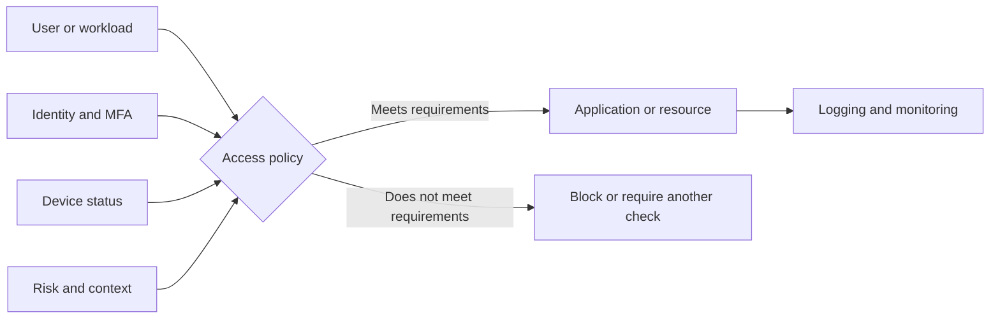
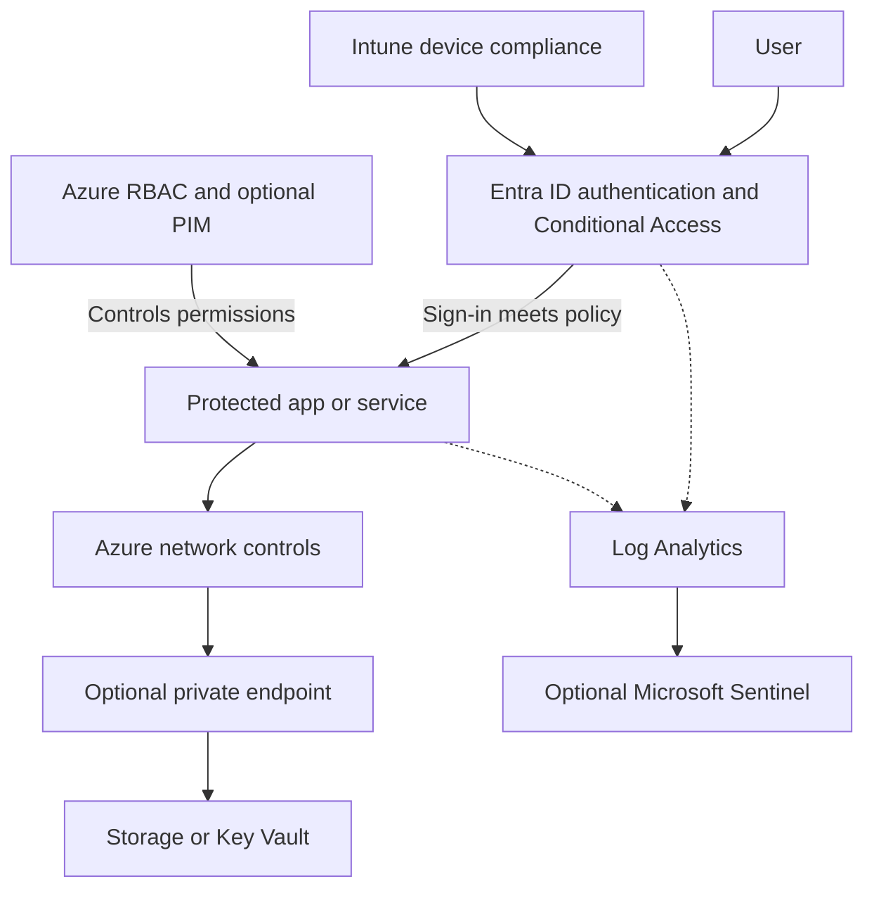

# ZeroTrustArchetecture

These are my notes on Zero Trust and how to set it up in Microsoft Azure. I'm starting with the basics, then working through the Microsoft services, configuration, and testing needed to put it into practice.

The goal is to understand what each control does, why it matters, and how the pieces work together. Zero Trust isn't a product you install or a setting you switch on.

## Part 1: Understanding Zero Trust

### What is Zero Trust?

Zero Trust means you don't automatically trust someone just because they're connected to your company network or signed in before. Access decisions should consider who they are, what device they're using, what they're trying to access, and whether the request looks legitimate.

A simple way to think about it:

- **Traditional security:** Once you're inside the network, you may have access to more than you need.
- **Zero Trust:** Every request is checked against policy, and access is limited to what is actually needed.

Zero Trust doesn't mean asking someone to enter their password every few minutes. It means using the right signals and controls to make better access decisions.

### The three main principles

| Principle | What it means | Example |
|---|---|---|
| **Verify explicitly** | Check identity and other relevant signals before granting access. | Require MFA and evaluate device compliance when accessing a sensitive application. |
| **Use least privilege** | Give users and services only the permissions they need. | Give an analyst read access to logs instead of broad Azure Contributor access. |
| **Assume breach** | Plan for an account, endpoint, or workload to be compromised. | Separate systems, restrict access between them, and monitor activity. |

### Basic access model

### Part 1 notes

1. [What is Zero Trust?](01-fundamentals/01-what-is-zero-trust.md)
2. [Principles and pillars](01-fundamentals/02-principles-and-pillars.md)
3. [Architecture models and diagrams](01-fundamentals/03-models-and-diagrams.md)
4. [Knowledge check](01-fundamentals/04-knowledge-check.md)

These cover the Microsoft principles, NIST SP 800-207, and the CISA Zero Trust Maturity Model.

## Part 2: Building Zero Trust in Azure

For the Azure side, I'm starting with identity security and permissions. From there, I'll add device compliance, network restrictions, and monitoring. Not every service is required for every environment, and some features need additional licenses.

### How the Azure pieces fit together

This is a simplified view, not a literal network traffic flow. Conditional Access evaluates supported sign-ins, Azure RBAC controls permissions, and private endpoints restrict network reachability. Each solves a different problem.

### Services to know

| Service | What I'd use it for | Needed to start? |
|---|---|---|
| **Microsoft Entra ID** | User identities, authentication, groups, and roles | Yes |
| **Entra Conditional Access** | Access rules based on users, apps, devices, and other signals | For policy-based access; generally requires P1 |
| **Microsoft Intune** | Device enrollment, compliance, and management | Optional |
| **Azure RBAC** | Limit access to Azure resources | Yes, for Azure resource permissions |
| **Entra PIM** | Just-in-time privileged role activation | Optional; licensing applies |
| **Azure Virtual Network and NSGs** | Network separation and traffic filtering | For network labs |
| **Azure Private Link** | Reach supported Azure services through private endpoints | Optional; billed |
| **Azure Monitor / Log Analytics** | Collect and investigate logs | Recommended; usage can cost money |
| **Microsoft Defender for Cloud** | Cloud security posture and workload protection | Optional; paid plans vary |
| **Microsoft Sentinel** | SIEM, detection rules, investigation, and hunting | Optional; ingestion and retention costs apply |

### Build order

| Step | What I'm setting up | Guide |
|---|---|---|
| 1 | Test tenant, users, licensing, and admin recovery | [Prerequisites](02-azure/01-prerequisites-and-licensing.md) |
| 2 | MFA and basic identity protection | [Build guide](02-azure/03-build-guide.md) |
| 3 | Conditional Access with report-only testing | [Lab 01](labs/lab-01-conditional-access-mfa.md) |
| 4 | Device compliance with Intune | [Lab 02](labs/lab-02-device-compliance.md) |
| 5 | Least-privilege permissions using Azure RBAC | [Lab 03](labs/lab-03-least-privilege.md) |
| 6 | VNet restrictions, Private Endpoint, and DNS | [Lab 04](labs/lab-04-private-endpoint.md) |
| 7 | Logs, KQL queries, and security monitoring | [Lab 05](labs/lab-05-logging-and-hunting.md) |

### Azure study notes

- [Azure overview and lab plan](02-azure/00-azure-overview.md)
- [Licensing and prerequisites](02-azure/01-prerequisites-and-licensing.md)
- [Target architecture](02-azure/02-target-architecture.md)
- [Full setup guide](02-azure/03-build-guide.md)
- [Services and tools](02-azure/04-services-and-tools.md)
- [Testing and rollback](02-azure/05-validation-and-rollback.md)
- [KQL examples](02-azure/06-kql-examples.md)

## Labs

These labs are meant for a test tenant or a small pilot group, not for turning on new policies across a production tenant without testing.

1. [Conditional Access and MFA](labs/lab-01-conditional-access-mfa.md)
2. [Intune device compliance](labs/lab-02-device-compliance.md)
3. [Azure RBAC and least privilege](labs/lab-03-least-privilege.md)
4. [Private Endpoint and DNS](labs/lab-04-private-endpoint.md)
5. [Logs and KQL hunting](labs/lab-05-logging-and-hunting.md)

## What I want to understand by the end

- Explain Zero Trust without treating it as just MFA or a VPN.
- Understand the NIST, Microsoft, and CISA models.
- Build and test a Conditional Access policy without locking out administrators.
- Understand the difference between authentication, authorization, and network access.
- Check device compliance and see how it affects access.
- Assign narrowly scoped roles in Azure.
- Set up and troubleshoot Private Endpoint connectivity and DNS.
- Use Entra sign-in logs, Azure logs, and KQL to validate the controls.

I'll use the [implementation checklist](templates/implementation-checklist.md) and [learning journal](templates/learning-journal.md) to track what I've tested and what still needs work.

## Things to watch out for

- Test Conditional Access in **report-only** mode first and keep emergency-access accounts available. Plan exclusions and rollback before enforcement.
- Understand the difference between **Security defaults** and **Conditional Access** before changing tenant-wide settings.
- Conditional Access generally requires **Entra ID P1**. Risk-based access policies generally require **P2**. Intune, PIM, Sentinel, and other services may have separate licensing or charges.
- Set a budget for Azure labs and clean up resources when they're no longer needed.
- Don't upload passwords, tokens, secrets, personal sign-in data, or internal configuration details to a public GitHub repository.

## References

- [Microsoft and NIST references](docs/references.md)
- [Glossary](docs/glossary.md)

This is a working set of study notes. I'll keep updating it as I test the labs and learn more.
