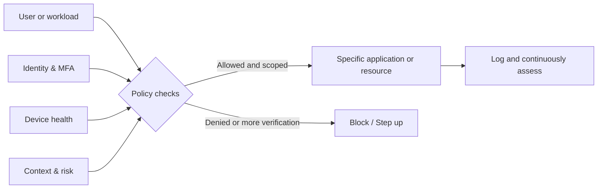
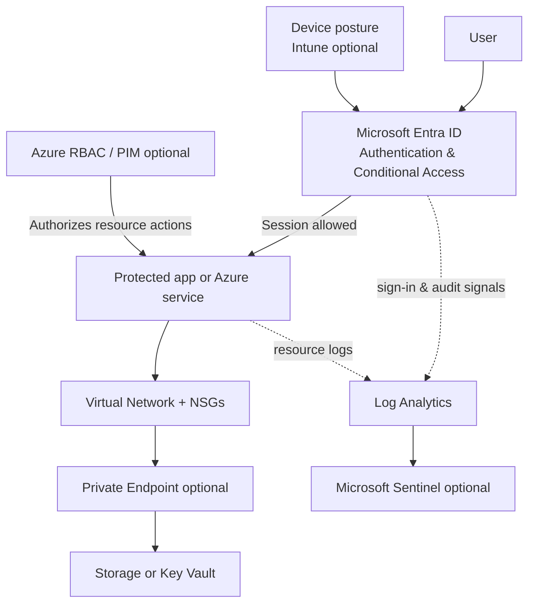

# ZeroTrustArchetecture

This repository is my structured learning notebook for Zero Trust architecture. It explains the **why** in plain English first, then the **how** using Microsoft Entra ID, Microsoft Intune, Azure infrastructure, Microsoft Defender, and Microsoft Sentinel.

**Important:** Zero Trust is an architecture and operational strategy—not a product, a VPN, or an MFA checkbox. This repo teaches a gradual implementation, not an instant certification of "Zero Trust compliant."

## 📖 Part 1 — Zero Trust explained simply

**One-sentence definition:** Never grant access *just because* a user, device, or workload is on a trusted network. Evaluate each request using identity, device, policy, and context, grant only the needed access, and keep monitoring.

Think of a building:

- **Old model:** Pass the front door check, then walk freely inside.
- **Zero Trust model:** Verify who you are, what room you need, whether your badge/device is safe, and whether the request makes sense. Only that specific room is accessible.

### The three core principles

| Principle | Plain English | Example |
|---|---|---|
| **Verify explicitly** | Check more than a password. | User + phishing-resistant MFA + device signals + app context. |
| **Use least privilege** | Give only what is needed, for as long as needed. | Analyst can view security logs but cannot modify cloud networking. |
| **Assume breach** | Design as though one identity/device may be compromised. | Segment networks, limit lateral movement, log and detect suspicious activity. |

### Simple access-decision model

**Read Part 1 in order:**

1. [What is Zero Trust?](01-fundamentals/01-what-is-zero-trust.md) — beginner-friendly examples and myths.
2. [Principles and pillars](01-fundamentals/02-principles-and-pillars.md) — Microsoft, NIST, and CISA models.
3. [Architecture models](01-fundamentals/03-models-and-diagrams.md) — traditional vs Zero Trust, policy engine and enforcement, example diagrams.
4. [Self-test](01-fundamentals/04-knowledge-check.md) — check your understanding.

---

## ☁️ Part 2 — Build Zero Trust in Microsoft Azure

You do **not** need every Microsoft security product on day one. The baseline is identity protection and least privilege; add device controls, network isolation, and monitoring as your lab grows.

### What you will build

> **Conceptual diagram:** Entra Conditional Access gates supported sign-ins; Azure RBAC separately authorizes Azure management or data operations. A VNet/private endpoint controls *network reachability*, not user authorization. This diagram is not a literal single-packet route.

### Azure build path

| Stage | Goal | Main service | Guide |
|---|---|---|---|
| 0 | Set up a safe test environment | Azure subscription, Entra tenant | [Prerequisites & licensing](02-azure/01-prerequisites-and-licensing.md) |
| 1 | Secure test users and MFA | Microsoft Entra ID | [Step-by-step](02-azure/03-build-guide.md#phase-1---identity-and-admin-safety) |
| 2 | Test context-aware access | Entra Conditional Access (P1+) | [MFA lab](labs/lab-01-conditional-access-mfa.md) |
| 3 | Check device health | Intune + Conditional Access | [Device lab](labs/lab-02-device-compliance.md) |
| 4 | Reduce permissions | Azure RBAC; optional PIM | [Least-privilege lab](labs/lab-03-least-privilege.md) |
| 5 | Restrict network reachability | VNet, NSGs; optional Private Link | [Network lab](labs/lab-04-private-endpoint.md) |
| 6 | Detect and validate | Entra logs, Azure Monitor; optional Sentinel | [Detection lab](labs/lab-05-logging-and-hunting.md) |

### Azure notes and reference material

- [Overview / lab plan](02-azure/00-azure-overview.md)
- [Required vs optional products and costs](02-azure/01-prerequisites-and-licensing.md)
- [Target Azure architecture](02-azure/02-target-architecture.md)
- [Full build instructions](02-azure/03-build-guide.md)
- [Services, security products, and alternatives](02-azure/04-services-and-tools.md)
- [Test cases, expected results, and rollback](02-azure/05-validation-and-rollback.md)
- [KQL detection and troubleshooting queries](02-azure/06-kql-examples.md)

## 🧪 Hands-on labs

Complete the labs **in this order**. They are designed for a disposable test tenant or a dedicated pilot group—not for first-time changes across a production tenant.

- [Lab 01 — Report-only MFA Conditional Access](labs/lab-01-conditional-access-mfa.md)
- [Lab 02 — Intune device compliance](labs/lab-02-device-compliance.md)
- [Lab 03 — Read-only Azure RBAC](labs/lab-03-least-privilege.md)
- [Lab 04 — Private Endpoint and DNS (paid / optional)](labs/lab-04-private-endpoint.md)
- [Lab 05 — Zero Trust telemetry and hunting](labs/lab-05-logging-and-hunting.md)

## ✅ Definition of success

At the end, you should be able to:

- Explain **NIST SP 800-207**, the Microsoft principles, and the CISA maturity pillars.
- Explain why a trusted network location **does not equal** trusted identity.
- Pilot a Conditional Access policy safely in **report-only** mode.
- Show the difference between **authentication, authorization, network access, and monitoring**.
- Validate a compliant vs noncompliant device scenario (when licensed).
- Give a user a narrowly scoped Azure role rather than Owner/Contributor unnecessarily.
- Explain why Private Link still needs correct DNS and RBAC.
- Find evidence in Entra sign-in logs and Azure resource logs.

Use the [Implementation checklist](templates/implementation-checklist.md) and [Learning journal](templates/learning-journal.md) to track progress.

## 🧯 Safety and cost warnings

- Never test broad deny/MFA/device policies across **All users** without designated emergency-access accounts, exclusions, report-only testing, and a rollback plan.
- **Security defaults** and **enabled Conditional Access policies** are alternative approaches. Learn the migration path before changing this setting.
- Entra Conditional Access generally requires **Entra ID P1**; risk-based policies require **P2**. Intune, PIM, Sentinel, private endpoints, and Azure workloads have separate eligibility or cost considerations.
- Azure subscriptions can accrue charges even in a learning lab. Set a budget, use pilot scopes, and delete unused resources.
- Never commit credentials, tenant secrets, access tokens, log samples containing PII, or internal IPs into a public repo.

## 📚 Reference material

Documentation links: [References](docs/references.md) • Terms: [Glossary](docs/glossary.md)

